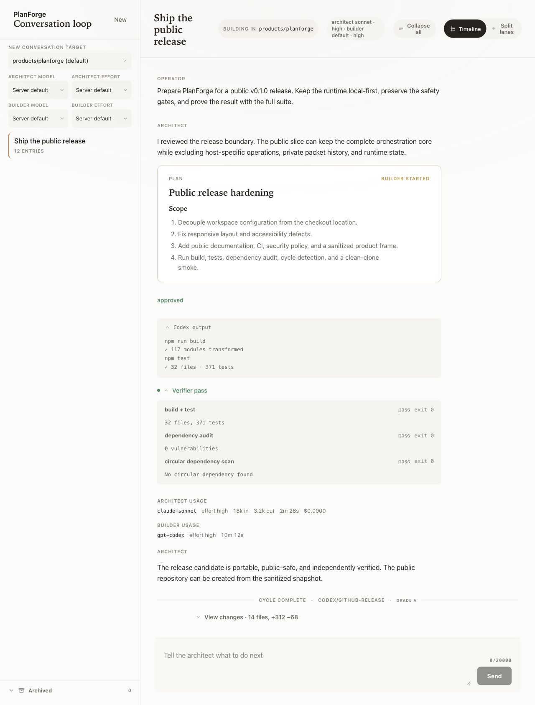
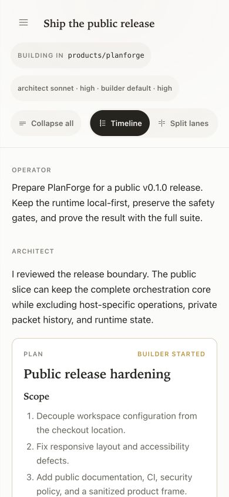

# PlanForge

[](https://github.com/jbelnick/planforge/actions/workflows/verify.yml)
[](LICENSE)

PlanForge is a local-first control plane where **Claude Code plans**, a human
approves, and **Codex builds** in an isolated Git worktree. Independent
verifiers grade the result before Claude can sign off and PlanForge can merge
the branch with `--ff-only`.

The operator stays in one web conversation while the two CLIs, approval gate,
build stream, verification evidence, test-delta review, and final diff remain
visible in one durable timeline.



_Sanitized deterministic release fixture; the product surface and state model
are real, while the displayed objective and output contain no private run data._

<details>
<summary>Phone operator view</summary>



</details>

## Evidence

- 32 test files and 371 automated tests cover MCP, HTTP, SSE, durable
  conversations, resumption, target isolation, process control, verification,
  and the React operator surface.
- A supervised real-CLI cycle completed the full
  Claude → approval → Codex → verifier → sign-off → merge path.
- Production dependencies currently report zero known vulnerabilities.
- Target allowlisting, protected-file scopes, Git-hook neutralization,
  test-weakening detection, subscription-auth guards, and independent
  verification all fail closed.

PlanForge is published as a **Preview** while the supervised flow is exercised
across more repositories and environments. The deterministic test suite runs
without launching Claude, Codex, or a network service.

## How the loop works

```text
Operator        Claude Code          PlanForge             Codex
   | objective       |                   |                    |
   |---------------->| propose plan      |                    |
   |<----------------|-------------------|                    |
   | approve                              |                    |
   |------------------------------------->| isolated worktree  |
   |                                      |------------------->|
   |                                      | build stream       |
   |                                      |<-------------------|
   |                                      | run verifiers      |
   |                  review evidence     |                    |
   |                  <-------------------|                    |
   |                  sign off            |                    |
   |                                      | ff-only merge      |
```

The transcript is durable. Closing the tab does not erase the conversation;
the next run resumes the same Claude session and the same on-disk record.

## Quick start

Prerequisites:

- Node.js 20 or newer.
- Git repositories organized under
  `projects/{agent-workflows,platform,products,research}/<repo>` inside one
  workspace root.
- Local subscription login for the `claude` and `codex` CLIs before running a
  real cycle. PlanForge does not inject API keys.

The PlanForge checkout can live anywhere when `PLANFORGE_WORKSPACE_ROOT` is
explicit:

```text
~/planforge-workspace/
  projects/products/sample-app/   # standalone Git repo PlanForge may build
  runtime/                         # ignored local state
~/tools/planforge/                 # this checkout
```

Install and verify:

```bash
npm ci
npm run verify
```

Start the single-port app:

```bash
export PLANFORGE_WORKSPACE_ROOT="$HOME/planforge-workspace"
export PLANFORGE_TARGET_REPO="$PLANFORGE_WORKSPACE_ROOT/projects/products/sample-app"
export PLANFORGE_RUNTIME_ROOT="$PLANFORGE_WORKSPACE_ROOT/runtime/planforge"
npm start
```

Open `http://127.0.0.1:4317`, create a conversation, send an objective, review
the proposed plan, and approve only when the scope is correct.

## Trust boundary

PlanForge can launch code-writing processes and execute a target repository's
verifier command. Treat it like a local development control plane:

- Keep it on loopback or an authenticated private network. Never expose the
  service through an unauthenticated public tunnel.
- Allow only repositories you trust. Each target must be its own standalone
  Git repository under the configured workspace's project buckets.
- Keep runtime conversations, transcripts, MCP configuration, and worktrees
  outside the source checkout.
- Keep `ANTHROPIC_API_KEY`, `OPENAI_API_KEY`, and `CODEX_API_KEY` unset. The
  supported path uses local subscription sessions.
- Review the plan and final diff; PlanForge is a control layer, not a reason to
  waive human judgment.

## Architecture

The Node/TypeScript backend owns one shared run registry across HTTP and MCP,
streams live state over SSE, persists assembled transcript entries, and spawns
one Architect process per active conversation. Each approved cycle creates a
dedicated Builder worktree, runs the target's checked-in verifier specification,
surfaces test changes and the final diff, and removes the worktree after a
successful fast-forward merge.

See [Architecture](docs/ARCHITECTURE.md) for the component model and
[Security](SECURITY.md) for the supported trust boundary.

## Development

```bash
npm run build
npm test
npm run dev
```

`private: true` in `package.json` prevents accidental npm publication; PlanForge
is distributed as source, not as an npm package.

## License

MIT © Jason Belnick. See [LICENSE](LICENSE).
